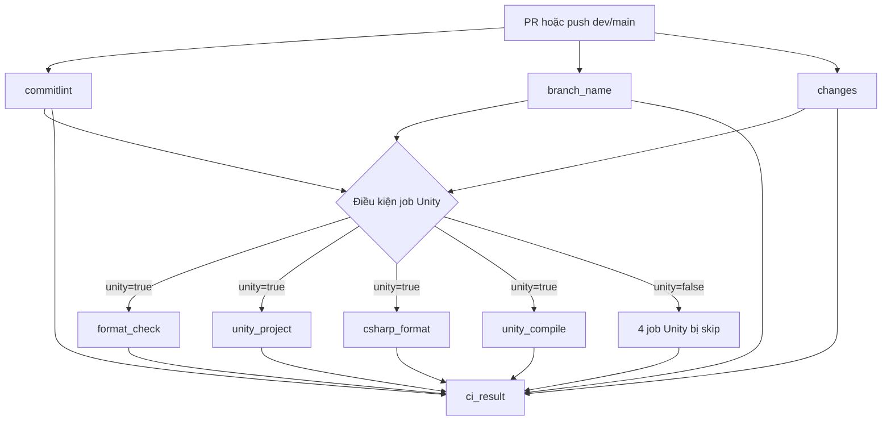

# CI của repo này làm gì

Tài liệu mô tả chi tiết `.github/workflows/ci.yml`: từng job kiểm tra gì, chạy khi nào, thời gian timeout và artifact sinh ra.

Nguồn luật của dự án vẫn là `AGENTS.md`; bảng tóm tắt ngắn nằm ở `docs/coding-conventions.md` mục 8. File này chỉ giải thích cơ chế của workflow.

## 1. Khi nào CI chạy

| Sự kiện | Điều kiện |
|---|---|
| `pull_request` | `opened`, `edited`, `reopened`, `synchronize` (sửa title cũng chạy lại) |
| `push` | Chỉ nhánh `dev` và `main` |

Cấu hình chung:

- `permissions`: `contents: read`, `checks: write` (để test runner tạo check run), `pull-requests: read`.
- `concurrency`: nhóm `ci-<workflow>-<ref>`, `cancel-in-progress: true` — push mới cùng nhánh sẽ hủy lần chạy cũ.
- Required check trên GitHub: chỉ cần bật job **`CI`** (`ci_result`), không bật từng job con.

## 2. Bảng tổng hợp

| Job | Tên hiển thị | Chạy khi | Timeout |
|---|---|---|---|
| `commitlint` | Commit message | Luôn chạy | 10 phút |
| `branch_name` | Branch name and PR flow | Chỉ `pull_request` | 5 phút |
| `changes` | Detect Unity changes | Luôn chạy | 5 phút |
| `format_check` | Format and syntax | Có thay đổi Unity + điều kiện lọc | 10 phút |
| `unity_project` | Unity project rules | Có thay đổi Unity + điều kiện lọc | 10 phút |
| `csharp_format` | C# format | Có thay đổi Unity + điều kiện lọc | 10 phút |
| `unity_compile` | Unity compile and EditMode test | Có thay đổi Unity + điều kiện lọc | 45 phút |
| `ci_result` | CI | Luôn chạy (`always()`) | 5 phút |

## 3. Chi tiết từng job

### 3.1 `commitlint` — Commit message

Không có `if`, luôn chạy ở cả PR và push.

Các bước:

1. `actions/checkout` với `fetch-depth: 0` (cần lịch sử để kiểm tra range commit).
2. Setup Node.js 20 + cache npm, chạy `npm ci`.
3. Xác định range commit:
   - PR: `from` = `pull_request.base.sha`, `to` = `pull_request.head.sha`.
   - Push: `from` = `github.event.before`, `to` = `github.sha`.
   - Nếu base rỗng hoặc toàn số `0` (nhánh mới), hoặc base không tồn tại trong clone thì fallback về `HEAD^`.
4. `commitlint --from <from> --to <to>` cho toàn bộ commit trong range.
5. Chỉ khi `pull_request`: kiểm tra thêm **PR title** bằng `commitlint`.

Fail khi: commit hoặc PR title không theo Conventional Commits (`<type>(scope): mô tả`). Log commitlint được đưa vào Step Summary.

### 3.2 `branch_name` — Branch name and PR flow

Chỉ chạy khi `github.event_name == 'pull_request'`. Khi push trực tiếp lên `dev`/`main`, job này bị **skip** và gate coi skip là hợp lệ.

Các bước:

1. `scripts/check-branch-name.sh "${{ github.head_ref }}"` — khớp regex nhánh:
   `main`, `dev`, `release/x.y.z`, `<type>/<ten>`, `dependabot/*`, `renovate/*`.
2. Kiểm tra luồng PR:
   - Vào `main`: chỉ chấp nhận `head` là `dev`.
   - Vào `dev`: chặn `head` là `main`.
   - Vào `release/*`: chặn `head` là `main`.
   - Đích khác: fail.

Fail khi: tên nhánh sai quy ước hoặc PR sai luồng.

### 3.3 `changes` — Detect Unity changes

Luôn chạy. Quyết định 4 job Unity có chạy hay không.

Cách tính:

1. Lấy `BASE_SHA` (`pull_request.base.sha` hoặc `github.event.before`), fallback `HEAD^` nếu rỗng/`0`/không tồn tại.
2. `MERGE_BASE = git merge-base BASE_SHA HEAD_SHA` (fallback `BASE_SHA`).
3. `git diff --name-only MERGE_BASE HEAD_SHA` trên đúng 3 thư mục:
   - `src/Recreate_The_World/Assets`
   - `src/Recreate_The_World/ProjectSettings`
   - `src/Recreate_The_World/Packages`
4. Ghi output `unity=true|false` và in danh sách file thay đổi vào Step Summary.

Lưu ý: sửa file ngoài 3 thư mục trên (ví dụ `src/Recreate_The_World/README.md`, `.github/`, `scripts/`) thì 4 job Unity bị skip và CI vẫn xanh.

### 3.4 `format_check` — Format and syntax

Chạy `scripts/check-format.sh`. Áp dụng cho file text mà git track hoặc file mới chưa add (theo `.gitignore`), gồm `*.cs`, `*.asmdef`, `*.json`, `*.yml`, `*.yaml`, `*.md`, `*.sh`, `*.cjs`, `*.mjs`, `*.js`, `*.ts`, `*.tsx`.

Kiểm tra:

- Có newline ở cuối file.
- Chỉ dùng LF, không CRLF.
- Là UTF-8 hợp lệ.
- Không có khoảng trắng cuối dòng (trừ `*.md`).
- Không dùng tab để thụt lề.
- `*.json` và `*.asmdef` parse được bằng Node.
- `*.yml`/`*.yaml` parse được bằng Ruby.

Artifact: `format-log` (chỉ upload khi fail).

### 3.5 `unity_project` — Unity project rules

Chạy `scripts/check-unity-project.sh` trên `src/Recreate_The_World`.

Kiểm tra:

1. Mỗi file/folder trong `Assets/` có `.meta` tương ứng, và không có `.meta` mồ côi.
2. Asmdef:
   - Reference dạng `GUID:` phải trỏ tới asmdef có thật trong project.
   - Assembly production không được tham chiếu assembly test (`*Test`, `*Tests`).
   - `Game.Core` không được tham chiếu assembly khác và phải có `"noEngineReferences": true`.
3. `Game.Core` không được xuất hiện `UnityEngine`/`UnityEditor` trong file `.cs`.
4. Không track `Library/`, `Temp/`, `Logs/`, `UserSettings/`, `Builds/`, `*.csproj`, `*.sln`, `*.slnx`.

Artifact: `unity-project-log` (chỉ upload khi fail).

### 3.6 `csharp_format` — C# format

1. Setup .NET SDK 8.
2. `dotnet tool restore` (tool khai báo trong `.config/dotnet-tools.json`).
3. `scripts/check-csharp-format.sh` chạy `dotnet csharpier --check src/Recreate_The_World/Assets --no-cache`.

Fail khi có file `.cs` chưa format. Cách sửa: `npm run format:csharp`.

Artifact: `csharp-format-log` (chỉ upload khi fail).

### 3.7 `unity_compile` — Unity compile and EditMode test

Đây là job duy nhất cần Unity license và Docker image.

Các bước:

1. `actions/checkout` với `lfs: true`, `fetch-depth: 1`.
2. **Check Unity license** — output `ready=true` nếu có một trong:
   - `UNITY_LICENSE`, hoặc
   - `UNITY_SERIAL`, hoặc
   - đồng thời `UNITY_EMAIL` + `UNITY_PASSWORD`.
   Nếu không có: ghi warning + Step Summary, `ready=false`.
3. **Cache Unity Library** — chỉ chạy khi `ready == 'true'`, dùng `actions/cache@v4`:
   - `path: src/Recreate_The_World/Library`
   - `key: Library-<os>-<hash ProjectVersion.txt>-<hash manifest.json + packages-lock.json>`
   - `restore-keys: Library-<os>-<hash ProjectVersion.txt>-` để dùng lại cache gần nhất khi vừa đổi package.
   - Cache hit: tải `Library/` có sẵn, bỏ qua import asset và tải package. Cache miss: Unity import lại, cuối job tự lưu cache mới nếu job thành công.
4. `docker pull unityci/editor:ubuntu-6000.3.29f1-linux-il2cpp-4` (bước này chạy kể cả khi thiếu license).
5. `game-ci/unity-test-runner@v4` — chỉ chạy khi `ready == 'true'`:
   - `unityVersion: 6000.3.29f1`
   - `projectPath: src/Recreate_The_World`
   - `testMode: editmode` (compile toàn project + chạy EditMode test)
   - `artifactsPath: artifacts/editmode`
   - `containerRegistryImageVersion: 4`
   - `checkName: Unity EditMode` (tạo GitHub check run)
6. Upload artifact `unity-editmode-results` (thư mục `artifacts/`) khi `always()` và có license.

Fail khi: compile lỗi hoặc test fail. Với CLI mới, job còn fail nếu Unity thoát code 0 nhưng không ghi file kết quả test (test không thực sự chạy).

Lưu ý quan trọng: nếu thiếu license, bước test bị **skip** nhưng job vẫn **success**, nên gate vẫn xanh. Muốn CI thực sự chặn lỗi compile thì phải cấu hình secret license.

### 3.8 `ci_result` — Gate

Luôn chạy (`if: always()`), phụ thuộc tất cả job trên. Không kiểm tra code, chỉ tổng hợp kết quả.

Bảng giá trị được chấp nhận:

| Job | Kết quả hợp lệ |
|---|---|
| `commitlint` | `success` |
| `branch_name` | `success` hoặc `skipped` (push trực tiếp) |
| `changes` | `success` |
| `format_check` | `success` hoặc `skipped` |
| `unity_project` | `success` hoặc `skipped` |
| `csharp_format` | `success` hoặc `skipped` |
| `unity_compile` | `success` hoặc `skipped` |

Quy tắc bổ sung: nếu `changes.outputs.unity == 'true'` thì **cả 4** job `format_check`, `unity_project`, `csharp_format`, `unity_compile` bắt buộc phải `success` (không được `skipped`).

Kết quả từng job cũng được in thành bảng trong Step Summary.

## 4. Sơ đồ phụ thuộc



Điều kiện chính xác của 4 job Unity:

```text
always()
&& needs.changes.outputs.unity == 'true'
&& needs.commitlint.result == 'success'
&& (needs.branch_name.result == 'success' || needs.branch_name.result == 'skipped')
```

## 5. Chạy kiểm tra ở local

| Lệnh | Tương ứng job |
|---|---|
| `npm run check:branch` | `branch_name` |
| `npm run check:format` | `format_check` |
| `npm run check:unity` | `unity_project` |
| `npm run check:csharp` | `csharp_format` |
| `npm run format:csharp` | Sửa format C# (không phải kiểm tra) |
| `echo "feat(x): mo ta" \| npx commitlint` | `commitlint` (một message) |

Compile + EditMode test cần Unity Editor hoặc Docker, không chạy được chỉ bằng lệnh Node. Trên máy có Unity, mở project `src/Recreate_The_World` và chạy Test Runner (EditMode).

## 6. Phạm vi hiện tại

CI hiện **chưa** làm những việc sau:

- Chưa chạy PlayMode test (chỉ EditMode).
- Chưa build thử game bằng `unity-builder`.
- Đã cache `Library/` theo `ProjectVersion.txt` + `manifest.json` + `packages-lock.json`; lần đầu hoặc khi đổi package vẫn phải import lại một lần.
- Chưa kiểm tra scene/prefab có `Missing` reference.
- Chưa gate coverage (report chỉ nằm trong artifact).
- Chưa có file test nào trong `Assets/Tests/EditMode` và `Assets/Tests/PlayMode`, nên phần "test" hiện chủ yếu là compile.

Kế hoạch mở rộng được ghi ở `docs/tech-stack.md` mục 4 (`unity-build-playmode.yml`, `web-ci.yml`, `web-cd.yml`).
